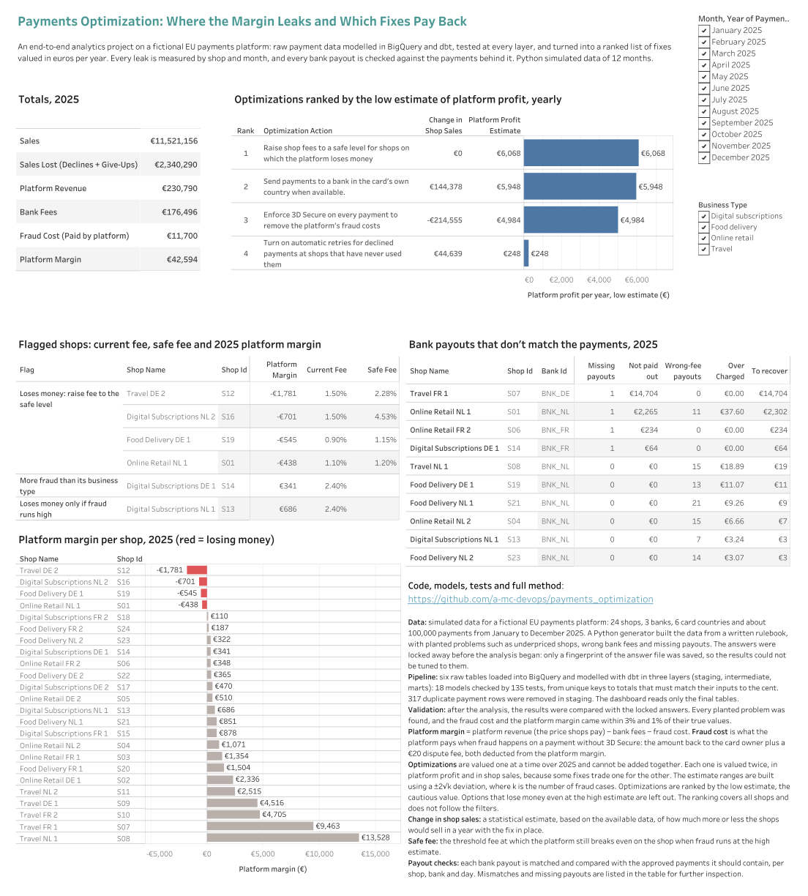
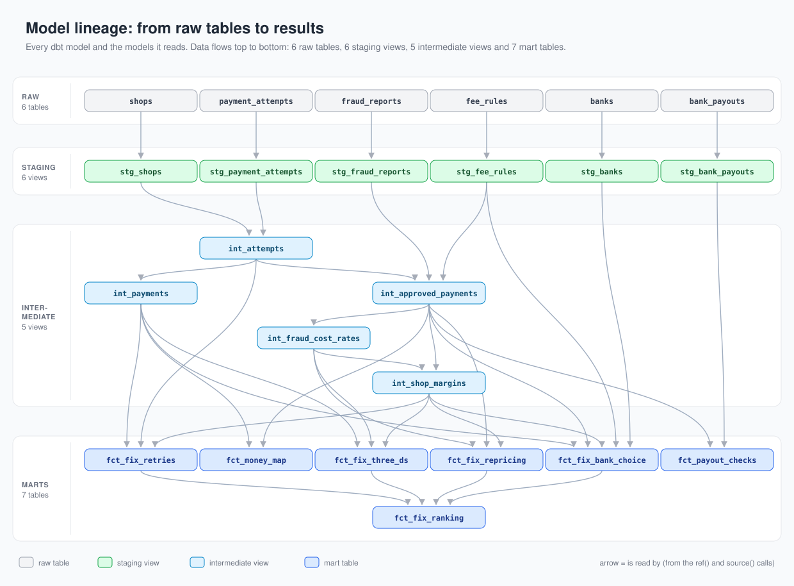

# Payments Optimization: Where the Margin Leaks and Which Fixes Pay Back

An end-to-end analytics project on simulated data from a fictional EU online card payment platform, modelled on providers such as Stripe and PayPal. The platform processes card payments for 24 shops, and the project answers one question: where does it lose money, and which fixes recover the most?

For additional analytical depth, the project adds a hypothetical marketing strategy: fraud costs, which payment platforms commonly deduct from their shops, are paid by the platform itself to grow its customer base of shops. When a stolen card is used on a payment without the 3D Secure check, the platform, not the shop, refunds the card owner and pays the €20 dispute fee. It's a strong offer for shops, but it puts the fraud risk on the platform's own margin.

In 2025 the platform kept only €42,594 of €11.5 million in sales, about €0.37 per €100. The project finds where the rest leaks (declined cards, bank fees, fraud and underpriced shops), puts a yearly € value on one fix for each, and ranks the fixes for a Head of Payments. A key part is what the fraud promise costs, and how 3D Secure settings trade fraud losses against customers who give up at the check. Every bank payout is also checked against the sales behind it: €17,357 is owed back by the banks.

Built with a Python data generator, a tested dbt pipeline on BigQuery, a Tableau dashboard and a recommendations report.

[](https://public.tableau.com/app/profile/cihan.ak.n/viz/PaymentsOptimization-MarginLeaksandFixes/Overview)

*Click the image to open the interactive dashboard on Tableau Public.*

## Results (2025, per year)

Each fix is valued on its own, both for the platform and for the shops, and the fixes are ranked by the low estimate of platform profit. The values are never added together, because some lost sales could be won back by more than one fix.

| Rank | Fix | Platform profit (low / best / high) | Shop sales | Depends on |
| ---: | --- | --- | ---: | --- |
| 1 | Reprice the 4 loss-making shops | €6,068 / €6,068 / €6,068 | €0 | the shops accept the new price |
| 2 | Send Dutch, German and French cards to their own country's bank (16 shops) | €5,948 | +€144,378 | the new bank accepts the shop |
| 3 | 3D Secure on every payment | €4,984 / €11,494 / €18,002 | −€214,555 | nothing outside the platform |
| 4 | Automatic retries at the 6 shops without them | €248 | +€44,639 | nothing outside the platform |
| 5 | 3D Secure on no payment | −€51,439 / −€31,118 / −€10,797 | +€478,588 | nothing outside the platform |

Separately, 4 bank payouts never arrived and 96 payouts carry a wrong fee: €17,357 to claim back from the banks.

## What I built

- **A layered dbt project on BigQuery:** 18 models from raw data to results (6 staging views, 5 intermediate views, 7 mart tables).
- **135 automated tests:** keys, relationships, allowed values, rules between columns and custom SQL checks, each broken once on purpose to prove it can fail.
- **Fix valuation:** a yearly € value for each fix, with low, best and high estimates where fraud makes the numbers uncertain.
- **Payout reconciliation:** every bank payout matched with the sales behind it, with an exception list of missing payouts and wrong fees.
- **Validation against sealed answers:** the simulated data came with a hidden answer file, fingerprinted before any analysis and opened once at the end.
- **A Tableau Public dashboard** and a [recommendations report](docs/recommendations.md) for the Head of Payments.

## Data quality

- **Raw data profiling:** every raw table was profiled before its staging model, by hand and with a reusable macro. It found 317 duplicate payment attempts, empty values that carry a meaning, and late fraud reports. The duplicates are removed in staging, the empty values are kept and tested, and fraud rates are measured on January–July payments, whose reports have all arrived.
- **dbt tests:** all 135 pass, and a failing test stops the build.
- **Payout check:** 4 missing payouts and 96 wrong fees found, all listed in an exception table.
- **Answer check:** every type of planted problem was found, and the year's fraud cost and margin came within 3% and 1% of the truth. The weak point is fraud per shop: 6 of 16 shop margins fall outside their estimated range.

## Read more

| Read | What it is |
| --- | --- |
| [Recommendations](docs/recommendations.md) | What to do, in what order, and what each action is worth |
| [Methods and checks](docs/methods_and_checks.md) | How every number is made and how it was checked, with a diagram for each step |
| [Data generation rulebook](docs/data_generation_rulebook.md) | The rules the simulated data follows |
| [Dashboard](https://public.tableau.com/app/profile/cihan.ak.n/viz/PaymentsOptimization-MarginLeaksandFixes/Overview) | The interactive Tableau Public page |

## How it is built

Python (data generator) → BigQuery → dbt → Tableau Public



The data is simulated, because real payment data is never published. A Python generator creates a year of payments (2025) from the [rulebook](docs/data_generation_rulebook.md): six raw tables with about 100,000 payments, plus planted problems (duplicate rows, late fraud reports, wrong bank fees and missing payouts). The hidden answer file's SHA-256 fingerprint was committed before any analysis ([`docs/answers_sha256.txt`](docs/answers_sha256.txt)); now that the analysis is finished, the file is in `data/answers/`, and `shasum -a 256 data/answers/answers.json` gives the committed fingerprint.

<details>
<summary><b>Rebuild</b></summary>

1. The six raw CSVs are already in `data/raw/`. To reproduce them (the fixed seed gives identical files):

   ```
   pip install -r python/requirements.txt
   python python/generate_data.py
   python python/check_generated_data.py
   ```

2. Load the six CSVs from `data/raw/` into a BigQuery dataset `raw` (location EU). Use the schemas in `bigquery/schemas/` with auto-detect off, so money columns load as exact `NUMERIC`. Then run `bigquery/check_load.sql`: every row should say PASS.
3. Run `dbt build` in `dbt/`.

</details>

<details>
<summary><b>Repository</b></summary>

- `docs/`: recommendations for the Head of Payments, methods and checks, data generation rulebook, answer-file fingerprint
- `python/`: data generator and its checks
- `bigquery/`: table schemas and the load check
- `dbt/`: models (`models/`), custom tests (`tests/`), macros (`macros/`) and the profiling queries (`analyses/`)
- `data/`: the six generated raw tables (`raw/`), the hidden answer file (`answers/`) and CSV exports of the dbt tables (`staging/`, `interim/`, `mart/`)
- `bi/`: the Tableau workbook and a PDF of the dashboard
- `images/`: the diagrams and the dashboard image

</details>
