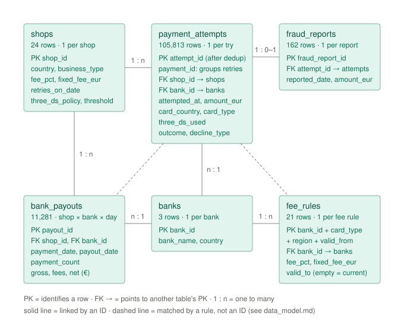

# Payments Optimization

Where does a payments platform lose money, and which fixes recover the most?

A fictional EU payments platform processes card payments for 24 shops. Money leaks in four
places:

- **Declined cards**: the customer wanted to pay, the sale was lost.
- **Bank fees**: some payments are routed to a more expensive bank than necessary.
- **Fraud**: the platform includes fraud protection in its price, so it pays for stolen-card
  payments made without the 3D Secure check (the amount back to the card owner plus a €20 dispute
  fee).
- **Underpriced shops**: shops paying the platform less than their payments cost it.

The project measures each leak per shop and month, estimates what each fix is worth per
year (bank choice, retrying declined payments, repricing shops, the 3D Secure security
check), and ranks the actions for a Head of Payments.

The scenario: fraud protection is the platform's selling point. Instead of passing fraud costs to
its shops, or forcing the 3D Secure check on every payment (which makes some customers give up),
the platform carries the cost of fraud on payments without the check. The project measures what
that guarantee costs, which business types make it expensive, and how different 3D Secure settings
would shift money between fraud losses and lost sales.

## About the data

The data is simulated. Real payment data is never published, and public practice datasets
had gaps that would have become the project. A Python generator creates a year of payments
(2025) from written-down rules in [`docs/rulebook.md`](docs/rulebook.md), plus a hidden
answer file that the analysis never reads. Its SHA-256 fingerprint was committed before any
analysis started ([`docs/answers_sha256.txt`](docs/answers_sha256.txt)). At the end, the
results are checked against those answers.

| Table | One row = | Rows |
| --- | --- | ---: |
| shops | shop | 24 |
| banks | bank | 3 |
| fee_rules | bank x card type x region x period | 21 |
| payment_attempts | one try to pay (retries are separate rows) | 106,130 |
| bank_payouts | shop x bank x payment day | 11,281 |
| fraud_reports | payment later reported as fraud | 162 |

How the tables connect (keys, joins, and a diagram): [`docs/data_model.md`](docs/data_model.md).



The data includes realistic mess on purpose: duplicate rows, fraud reports that arrive
late, one bank's payouts with wrong fees, and a few missing payouts. What profiling found,
and the cleaning plan: [`docs/profiling_notes.md`](docs/profiling_notes.md).

Rebuild the data (the fixed seed gives identical files):

```
pip install -r python/requirements.txt
python python/generate_data.py
python python/check_generated_data.py
```

## Repository

- `docs/`: rulebook, answer-file fingerprint, data model, profiling notes
- `images/`: diagrams (table relationships, money flow of one payment)
- `dbt/`: dbt project: staging models with tests (`models/staging/`), a custom test (`tests/`),
  a profiling macro that profiles any table (`macros/profile_table.sql`), profiling queries
  (`analyses/`)
- `python/`: data generator and checks
- `bigquery/`: table schemas, load guide and load check
- `data/`: generated files (not in git)

## Stack

Python (data generator) → BigQuery → dbt → Power BI

## Status

Stage 2 of 7 complete:

1. Data generated, checked and loaded into BigQuery.
2. Raw data profiled; one staging model per raw table in dbt (renames, and 317 duplicate payment
   attempts removed), each with tests: keys, empty values, allowed values, links between tables,
   and rules between columns. `dbt build` passes all 69 tests.

Next: core models (payments, fees, money per shop and month).
