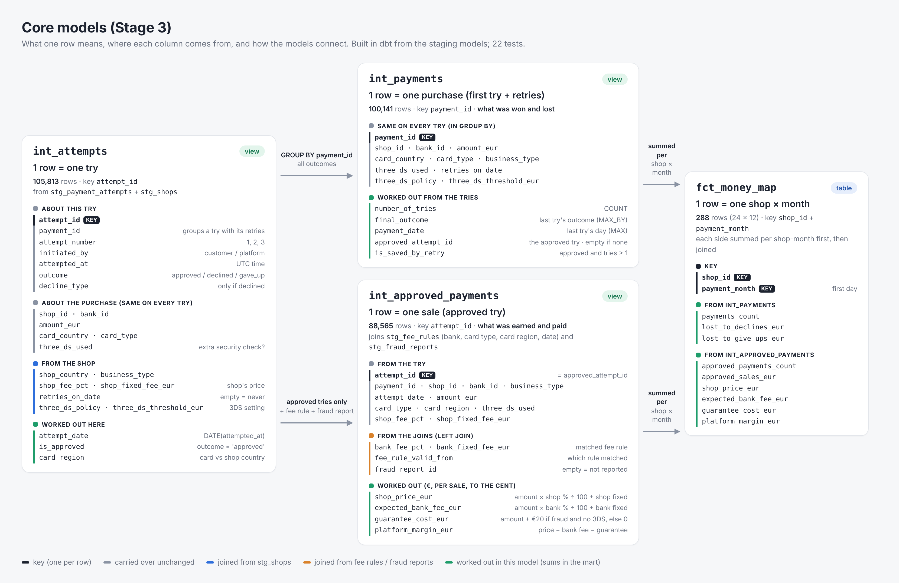
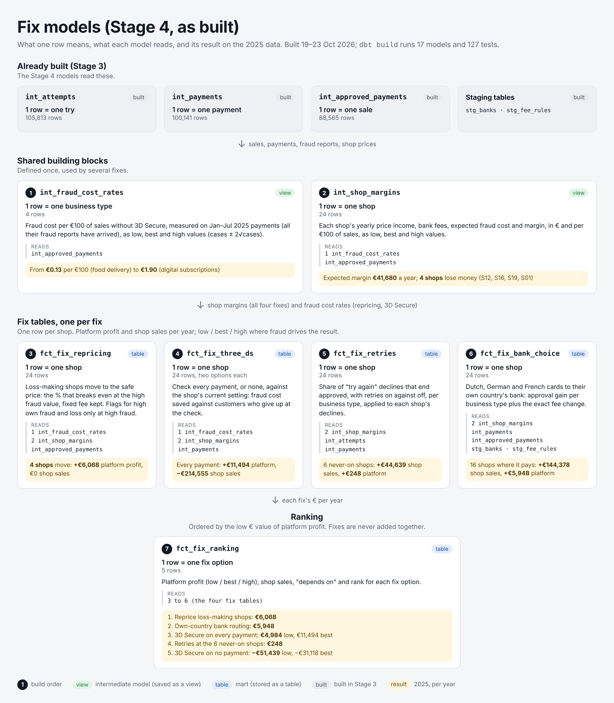

# Payments Optimization

Where does a payments platform lose money, and which fixes recover the most?

A fictional EU payments platform processes card payments for 24 shops. Money leaks in four
places:

- **Declined cards**: the customer wanted to pay, the sale was lost.
- **Bank fees**: some payments are routed to a more expensive bank than necessary.
- **Fraud**: the platform includes fraud protection in its price, so it pays for stolen-card
  payments made without the 3D Secure check (the amount back to the card owner plus a €20 dispute
  fee).
- **Underpriced shops**: shops paying the platform less than their payments cost it.

The project measures each leak per shop and month, estimates what each fix is worth per
year (bank choice, retrying declined payments, repricing shops, the 3D Secure security
check), and ranks the actions for a Head of Payments.

The scenario: fraud protection is the platform's selling point. Instead of passing fraud costs to
its shops, or forcing the 3D Secure check on every payment (which makes some customers give up),
the platform carries the cost of fraud on payments without the check. The project measures what
that guarantee costs, which business types make it expensive, and how different 3D Secure settings
would shift money between fraud losses and lost sales.

## About the data

The data is simulated. Real payment data is never published, and public practice datasets
had gaps that would have become the project. A Python generator creates a year of payments
(2025) from written-down rules in [`docs/rulebook.md`](docs/rulebook.md), plus a hidden
answer file that the analysis never reads. Its SHA-256 fingerprint was committed before any
analysis started ([`docs/answers_sha256.txt`](docs/answers_sha256.txt)). At the end, the
results are checked against those answers.

| Table | One row = | Rows |
| --- | --- | ---: |
| shops | shop | 24 |
| banks | bank | 3 |
| fee_rules | bank x card type x region x period | 21 |
| payment_attempts | one try to pay (retries are separate rows) | 106,130 |
| bank_payouts | shop x bank x payment day | 11,281 |
| fraud_reports | payment later reported as fraud | 162 |

How the tables connect (keys, joins, and a diagram): [`docs/data_model.md`](docs/data_model.md).


The data includes realistic mess on purpose: duplicate rows, fraud reports that arrive
late, one bank's payouts with wrong fees, and a few missing payouts. What profiling found,
and the cleaning plan: [`docs/profiling_notes.md`](docs/profiling_notes.md).

Rebuild the data (the fixed seed gives identical files):

```
pip install -r python/requirements.txt
python python/generate_data.py
python python/check_generated_data.py
```

## Core models

Built in dbt on top of the staging models (details: [`docs/data_model.md`](docs/data_model.md#core-models-stage-3)):

| Model | One row = | Rows | What it holds |
| --- | --- | ---: | --- |
| `int_attempts` | one try | 105,813 | each try with its shop's details, its day, approved yes/no, and its bank-fee group |
| `int_payments` | one payment (first try + retries) | 100,141 | what was won and lost: final outcome, number of tries, saved by a retry |
| `int_approved_payments` | one sale | 88,565 | what was earned and paid: shop price, expected bank fee, fraud guarantee cost, margin |
| `fct_money_map` | one shop x month | 288 | the money map: sales, price, bank fees, fraud cost, margin, and sales lost to declines and give-ups |



Tests prove that no join doubled or dropped a row: every sale matches exactly one bank fee rule,
the approved try is always a payment's last, and the money map's totals equal those of its inputs
to the cent.

## Fix models

Each fix gets a euro value per year, measured on 2025, in two ways: platform profit and shop sales.
Where the value rests on fraud data (few cases), it has a low/high range, and the ranking orders the
fixes by the low value: the money the platform is fairly sure of. How each fix is valued, the
alternatives considered and the full results: [`docs/fix_methods.md`](docs/fix_methods.md).

| Model | One row = | What it holds |
| --- | --- | --- |
| `int_fraud_cost_rates` | business type | fraud cost per €100 of sales without 3D Secure, measured on January–July 2025 (all fraud reports in), low/best/high |
| `int_shop_margins` | shop | price income, bank fees, expected fraud cost and margin |
| `fct_fix_repricing` | shop | safe price for loss-making shops, extra price income, fraud flags |
| `fct_fix_three_ds` | shop | checking every payment or none: fraud saved against customers lost at the check |
| `fct_fix_retries` | shop | sales rescued by automatic retries, beyond customers' own retries |
| `fct_fix_bank_choice` | shop | approval gain and fee change from sending cards to their own country's bank |
| `fct_fix_ranking` | fix option | the five options, ranked |



Results (2025, per year):

| Rank | Fix | Platform profit (low / best / high) | Shop sales | Depends on |
| ---: | --- | --- | ---: | --- |
| 1 | Reprice the 4 loss-making shops | €6,068 / €6,068 / €6,068 | €0 | the shops accept the new price |
| 2 | Send Dutch, German and French cards to their own country's bank | €5,948 | +€144,378 | the new bank accepts the shop |
| 3 | 3D Secure on every payment | €4,984 / €11,494 / €18,002 | −€214,555 | nothing outside the platform |
| 4 | Automatic retries at the 6 shops without them | €248 | +€44,639 | nothing outside the platform |
| 5 | 3D Secure on no payment | −€51,439 / −€31,118 / −€10,797 | +€478,588 | nothing outside the platform |

- The platform keeps about €0.37 of every €100 of sales, so fixes that save sales are worth far more
  to the shops than to the platform.
- The two most certain platform gains both depend on someone outside the platform.
- Checking every payment gains the platform €1 for about every €19 of sales the shops lose.

## Repository

- `docs/`: rulebook, answer-file fingerprint, data model, profiling notes, fix methods (Stage 4)
- `images/`: diagrams (table relationships, core models, fix models)
- `dbt/`: dbt project: staging models (`models/staging/`), core and fix models (`models/intermediate/`,
  `models/marts/`), each with a YAML file of tests; custom SQL tests (`tests/`); a profiling macro
  that profiles any table (`macros/profile_table.sql`); profiling queries (`analyses/`)
- `python/`: data generator and checks
- `bigquery/`: table schemas, load guide and load check
- `data/`: generated files (not in git)

## Stack

Python (data generator) → BigQuery → dbt → Power BI

## Status

Stage 4 of 7 complete:

1. Data generated, checked and loaded into BigQuery.
2. Raw data profiled; one staging model per raw table in dbt (renames, and 317 duplicate payment
   attempts removed), each with tests: keys, empty values, allowed values, links between tables,
   and rules between columns.
3. Core models: tries, payments, sales with their fees and fraud cost, and a money map per shop and
   month, with 22 tests.
4. Fix calculations: seven models, with 36 tests, put a yearly euro value on each fix and rank them.
   `dbt build` runs 17 models and 127 tests.

Next: Stage 5, checks: an exception list of bank payouts that don't match the payments, and a comparison
of the results with the hidden answer file.
