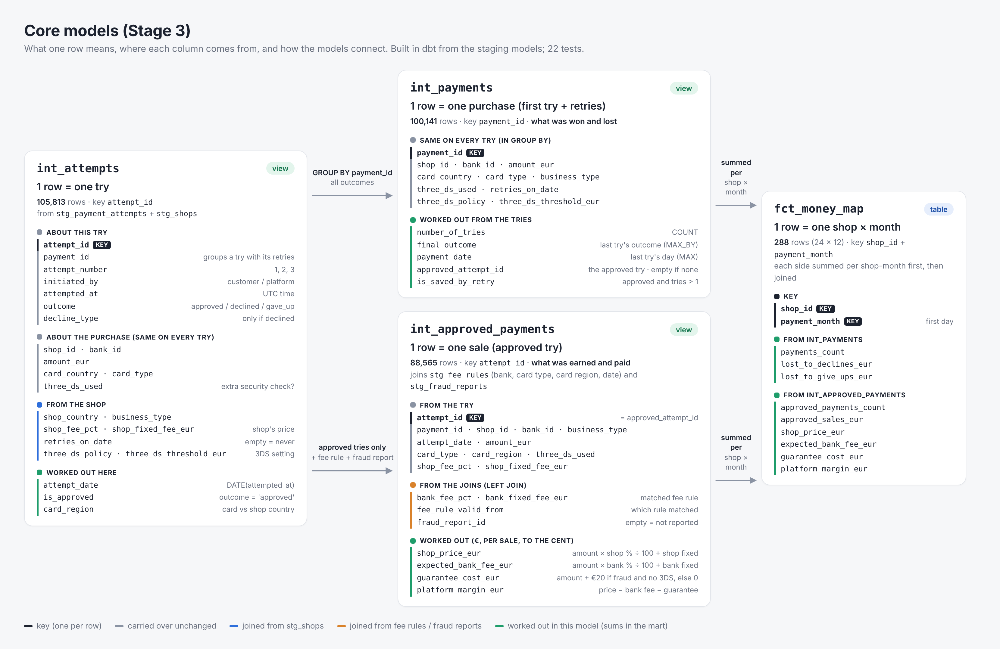

# Data model

How the raw tables fit together: what one row means, what identifies it, and how tables connect.
Diagram: `images/erd.svg`. The core models built from them (Stage 3) are described
[at the end](#core-models-stage-3).

## The tables

| Table | One row = | Rows | Key (identifies a row) | Points to |
| --- | --- | ---: | --- | --- |
| shops | one shop | 24 | `shop_id` | – |
| banks | one bank | 3 | `bank_id` | – |
| fee_rules | one bank's fee for one card type and card region, during one period | 21 | `bank_id` + `card_type` + `region` + `valid_from` | banks |
| payment_attempts | one try to pay (retries are extra rows) | 106,130 raw, 105,813 after removing duplicates | `attempt_id` (only after removing duplicates) | shops, banks |
| bank_payouts | one bank's payout for one shop's approved payments on one day (paid to the platform, rulebook §9) | 11,281 | `payout_id` (also unique: `shop_id` + `bank_id` + `payment_date`) | shops, banks |
| fraud_reports | one approved payment later reported as fraud | 162 | `fraud_report_id` | payment_attempts |

`payment_id` is not a key. It groups a first try with its retries, so it repeats on purpose
(105,813 tries belong to 100,141 payments).

## How the tables connect

**Linked by an ID** (solid lines in the diagram). Join on the column, no extra logic:

| From | To | Join on | How many |
| --- | --- | --- | --- |
| payment_attempts | shops | `shop_id` | many tries per shop |
| payment_attempts | banks | `bank_id` | many tries per bank |
| bank_payouts | shops | `shop_id` | many payouts per shop |
| bank_payouts | banks | `bank_id` | many payouts per bank |
| fee_rules | banks | `bank_id` | 6–9 rules per bank |
| fraud_reports | payment_attempts | `attempt_id` | 0 or 1 report per try |

**Matched by a rule** (dashed lines). There's no shared ID, so you match on several columns:

- **Try → fee rule:** same `bank_id` and `card_type`; `region` worked out from the card's country vs
  the **shop's** country (same = domestic; other NL/DE/FR/ES = other_eu; UK/US = non_eu); and the
  payment date between `valid_from` and `valid_to` (empty `valid_to` = still valid).
  Should give exactly one rule per approved try.
- **Tries → payout:** approved tries summed per shop, bank and approval day should equal one payout
  row (count, gross amount, fees). This is the Stage 5 comparison, and it's where wrong fees and
  missing payouts show up.

## Watch out when joining

- Remove the 317 duplicate tries first, or every join from `payment_attempts` counts them twice.
- One shop or bank joins to many rows. Join small tables onto big ones (tries → shops), not the
  other way round, or totals multiply.
- Fraud reports are a lower bound: reports arriving after 31 Jan 2026 are missing, so late 2025
  looks too low.
- Fee % columns are percents: 1.6 means 1.6%, so divide by 100 in calculations.
- Dates line up in UTC: all times are UTC and a payout's day is the approval day in UTC (rulebook §9),
  so `DATE(attempted_at)` matches `bank_payouts.payment_date` without any timezone conversion.
- `gave_up` tries carry a `bank_id` (the bank they would have gone to) but had no bank decision:
  don't count them as declined.
- `payment_id` repeats on purpose (a first try and its retries); never treat it as a key.

## Column names in staging

Rule: one column name = one meaning across all tables. A name that two joined tables share must mean
the same thing (join keys); anything else gets a prefix saying whose it is, or a join gives two
`country` columns and BigQuery stops with "column name is ambiguous".

All renames below are built (Stage 2, Oct 2026).

| Model | Raw name | Staging name | Why |
| --- | --- | --- | --- |
| stg_shops | `country` | `shop_country` | clashes with banks |
| stg_shops | `fee_pct`, `fixed_fee_eur` | `shop_fee_pct`, `shop_fixed_fee_eur` | clash with bank fees |
| stg_banks | `country` | `bank_country` | clashes with shops |
| stg_fee_rules | `fee_pct`, `fixed_fee_eur` | `bank_fee_pct`, `bank_fixed_fee_eur` | clash with shop prices |
| stg_fee_rules | `region` | `card_region` | the card's country vs the **shop's** country (rulebook §5) |
| stg_fraud_reports | `amount_eur` | `fraud_amount_eur` | clashes with `payment_attempts.amount_eur` |
| stg_bank_payouts | `fees_eur` | `bank_fees_eur` | "fees" alone could mean bank fee or shop price |

Kept as they are, because they mean the same thing in every table: `shop_id`, `bank_id`,
`attempt_id`, and `card_type` (payment_attempts joins fee_rules on it). `card_country` already
says whose it is.

## Turning the diagram into checks

Every part of the diagram suggests a check:

| In the diagram | Check to run |
| --- | --- |
| A key (PK) | unique and never empty |
| A solid line (FK) | every ID exists in the other table (LEFT JOIN … WHERE other.id IS NULL) |
| A dashed line | the rule match gives exactly one row, and counts and sums agree |
| A row count | does it match what the rulebook expects? |

In dbt, relationships tests point to the staging model (`stg_shops`), not to the raw source.
Rules between columns or tables need more than the four built-in tests; they are listed per table
under "Tests to add" in `docs/profiling_notes.md`.

## Core models (Stage 3)

Built in dbt from the staging models: three intermediate views and one mart table. Diagram:
`images/core_models.png`.

| Model | Layer | One row = | Rows | Key | Built from |
| --- | --- | --- | ---: | --- | --- |
| `int_attempts` | intermediate (view) | one try | 105,813 | `attempt_id` | `stg_payment_attempts` + `stg_shops` |
| `int_payments` | intermediate (view) | one payment (first try + its retries) | 100,141 | `payment_id` | `int_attempts`, grouped by `payment_id` |
| `int_approved_payments` | intermediate (view) | one sale (approved try) | 88,565 | `attempt_id` | `int_attempts` (approved only) + `stg_fee_rules` + `stg_fraud_reports` |
| `fct_money_map` | mart (table) | one shop x month | 288 | `shop_id` + `payment_month` | `int_payments` + `int_approved_payments` |

`int_payments` holds what was won and lost (every purchase, whatever its outcome);
`int_approved_payments` holds what was earned and paid on each sale. Both feed the money map.

### What each model adds

- **`int_attempts`**: each try with its shop's columns (`shop_country`, `business_type`,
  `shop_fee_pct`, `shop_fixed_fee_eur`, `retries_on_date`, `three_ds_policy`,
  `three_ds_threshold_eur`) and three worked-out columns: `attempt_date` (`DATE(attempted_at)`, UTC),
  `is_approved`, and `card_region` (card country vs the shop's country: domestic / other_eu /
  non_eu). Later models read `card_region` from here; nothing recalculates it.
- **`int_payments`**: the columns that are the same on every try of a payment (shop, bank, amount,
  card, business type, 3D Secure, the shop's retry and 3D Secure settings), plus
  `number_of_tries`, `final_outcome` (the last try's outcome), `payment_date` (the last try's day),
  `approved_attempt_id` (empty if never approved) and `is_saved_by_retry` (approved after more than
  one try).
- **`int_approved_payments`**: the matched fee rule (`bank_fee_pct`, `bank_fixed_fee_eur`,
  `fee_rule_valid_from`), `fraud_report_id` (empty = not reported), and four money columns per sale,
  each rounded to the cent:
  - `shop_price_eur` = amount x shop % / 100 + shop fixed fee
  - `expected_bank_fee_eur` = amount x bank % / 100 + bank fixed fee
  - `guarantee_cost_eur` = amount + €20 when reported as fraud and 3D Secure was not used, else 0
  - `platform_margin_eur` = shop price - expected bank fee - guarantee cost
- **`fct_money_map`**: per shop and month, `payments_count`, `lost_to_declines_eur` and
  `lost_to_give_ups_eur` (from `int_payments`), and `approved_payments_count`,
  `approved_sales_eur`, `shop_price_eur`, `expected_bank_fee_eur`, `guarantee_cost_eur`,
  `platform_margin_eur` (from `int_approved_payments`), all summed.

### Rules the models follow

- A payment counts on the day of its last try (the approval day for approved payments). No payment
  spans two months.
- Fee rule match: same `bank_id`, `card_type` and `card_region`, and the approval date between
  `valid_from` and `valid_to` (`valid_to` is the last valid day; empty = still valid). Every sale
  matches exactly one rule.
- The guarantee cost counts in the sale's month, not the month of the report. Only reported fraud
  is counted, so late 2025 is a lower bound (any correction belongs to Stage 4).
- `expected_bank_fee_eur` is the fee the rules say the bank should take. `bank_fees_eur` (in
  `stg_bank_payouts`) is what the bank actually took. Stage 5 compares the two.
- The money map sums each input per shop-month first, then joins on `shop_id` + `payment_month`,
  so one row meets one row.

### How joins are kept from multiplying rows

| Join | Why it cannot add rows | Proven by |
| --- | --- | --- |
| tries → shops | `shop_id` is unique in `stg_shops` | `equal_rowcount`: `int_attempts` = `stg_payment_attempts` |
| sales → fee rules | the four conditions cover the full key of a fee rule | `unique` on `int_approved_payments.attempt_id` |
| sales → fraud reports | at most one report per try | same test |
| payments ↔ sales, per shop-month | both sides have one row per shop + month | `unique_combination_of_columns` (`shop_id`, `payment_month`) and the totals test |

### Tests (22)

Every test below was made to fail once on purpose, then fixed back.

| Model | Tests | What they prove |
| --- | --- | --- |
| `int_attempts` | `attempt_id` unique + not_null; `equal_rowcount` vs `stg_payment_attempts`; `card_region` not_null + accepted_values; `payment_id` unique where `is_approved`; `payment_id` relationships → `int_payments` | no try doubled or lost by the shop join; every try has a fee group; at most one approved try per payment; no payment lost when tries are grouped |
| `int_payments` | `payment_id` unique + not_null; `final_outcome` not_null + accepted_values; `approved_attempt_id` relationships → `int_approved_payments`; rule: `approved_attempt_id` filled exactly when `final_outcome` = approved | one row per payment; the approved try is always the last; no sale lost |
| `int_approved_payments` | `attempt_id` unique + not_null; `expected_bank_fee_eur` not_null; rule: 0 < fee < amount; rule: guarantee cost > 0 exactly when reported and no 3D Secure | exactly one fee rule per sale; fee % divided by 100; the guarantee follows rulebook §8 |
| `fct_money_map` | `unique_combination_of_columns` (`shop_id`, `payment_month`); `approved_sales_eur`, `platform_margin_eur` not_null; singular test `dbt/tests/assert_money_map_totals_match.sql` | one row per shop-month; the map's totals equal those of its inputs, so no money was doubled or lost |
