# Methods and Checks

This document shows how the raw data was cleaned, modeled, tested and analyzed into a ranked list of fixes, and how each step was checked. 
The data itself is described in [data_generation_rulebook.md](data_generation_rulebook.md). 
What the results mean for the business is in [recommendations.md](recommendations.md).

1. [Raw data](#raw-data)
2. [Profiling and cleaning](#profiling-and-cleaning)
3. [Macros](#macros)
4. [Models](#models)
5. [Tests](#tests)
6. [How each fix is valued](#how-each-fix-is-valued)
7. [Payout checks](#payout-checks)
8. [Checked against the hidden answers](#checked-against-the-hidden-answers)
9. [Dashboard](#dashboard)

## Raw data

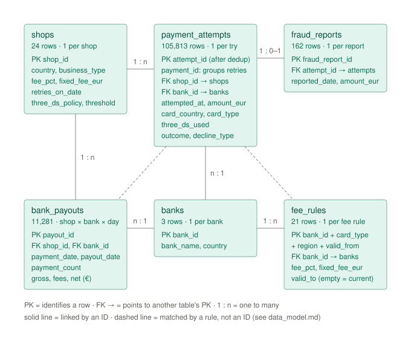

- **shops**: one row per shop (24)
- **banks**: one row per bank (3)
- **fee_rules**: one bank's fee for one card type and card region over a period (21)
- **payment_attempts**: one row per try to pay; retries are extra rows (106,130)
- **bank_payouts**: one bank's payout to the platform for one shop's sales on one day (11,281)
- **fraud_reports**: one approved payment later reported as fraud (162)

`payment_id` in `payment_attempts` groups a first try with its retries, so it repeats on purpose.

Most tables join on an ID. Two joins need a rule instead:

- A sale finds its fee rule by bank, card type, card region and date. The card region compares the card's country with the shop's: same country, another EU country, or the UK or US.
- One shop's sales at one bank on one day should add up to one payout. This is the payout check.

## Profiling and cleaning

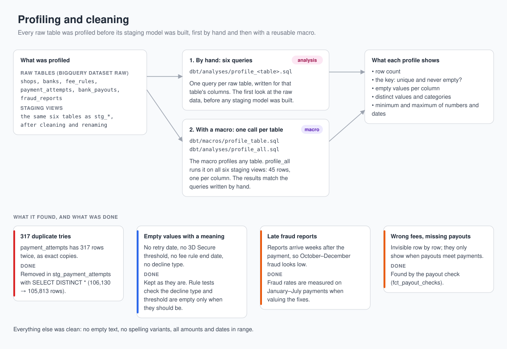

Each raw table was profiled before building its staging model: row count, key, empty values, categories, and minimum and maximum. This was done in two ways:

- **Manual SQL queries:** one query per table, in `dbt/analyses/profile_<table>.sql`. These dbt analyses are compiled by dbt but not built as tables; they are the only analyses in the project.
- **Jinja macro:** `profile_table` (see [Macros](#macros)), run on all six staging models by `dbt/analyses/profile_all.sql`. The results match the queries written manually.

Key findings from the data profiling and the decision made on each:

- **317 duplicate rows in payment_attempts.** Removed in staging with `SELECT DISTINCT *` (106,130 → 105,813 rows).
- **Empty values that mean something:** no retry date (retries were never switched on), no 3D Secure threshold (the shop doesn't use that setting), no end date on a fee rule (still valid), no decline type (the try wasn't declined). Kept as they are.
- **Late fraud reports:** a fraud report arrives 45 days after the payment on average, and up to 26 weeks later. Reports that would arrive after the data was pulled (31 Jan 2026) are missing, so late-2025 fraud looks too low. Handled by measuring fraud rates per business type on January–July payments, whose reports have all arrived, and applying them to the whole year (`int_fraud_cost_rates` and `int_shop_margins`).
- **Wrong bank fees and missing payouts,** which only show when payouts are compared with payments. Handled by the [payout check](#payout-checks).

## Macros

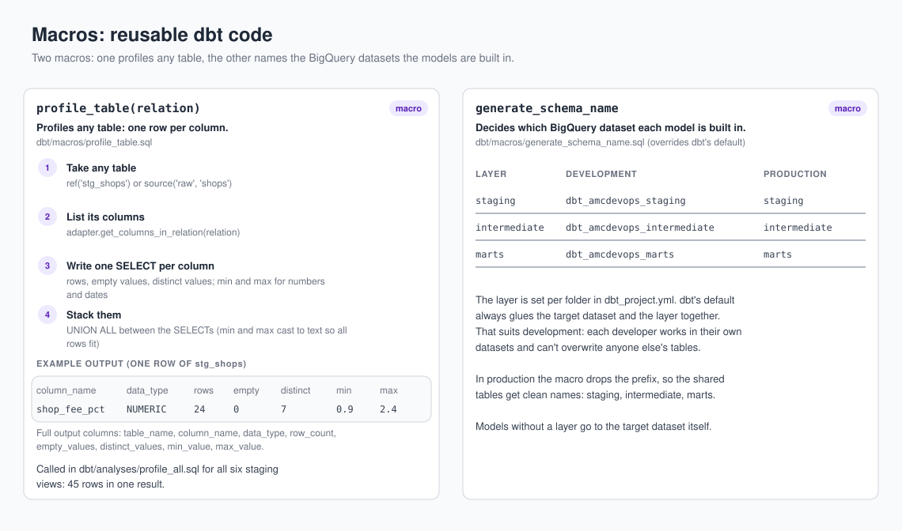

- **profile_table** profiles any table: it lists the table's columns and returns one row per column with row count, empty values, distinct values, and minimum and maximum. `dbt/analyses/profile_all.sql` runs it on all six staging models.
- **generate_schema_name** decides which BigQuery dataset each model is built in. In development the datasets carry a personal prefix (`dbt_amcdevops_staging`); in production they get clean names (`staging`, `intermediate`, `marts`).

## Models

dbt builds 18 models in three layers: 6 staging views, 5 intermediate views and 7 mart tables.

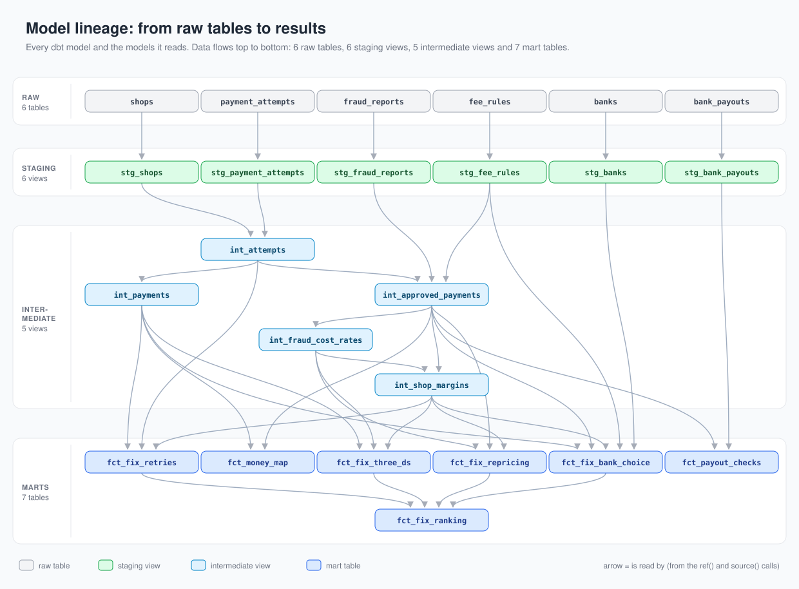

### Staging models

One view per raw table. Columns are renamed so that one name means the same thing in every table (for example, `country` becomes `shop_country` or `bank_country`), and `stg_payment_attempts` removes the 317 duplicate rows. Nothing else changes.

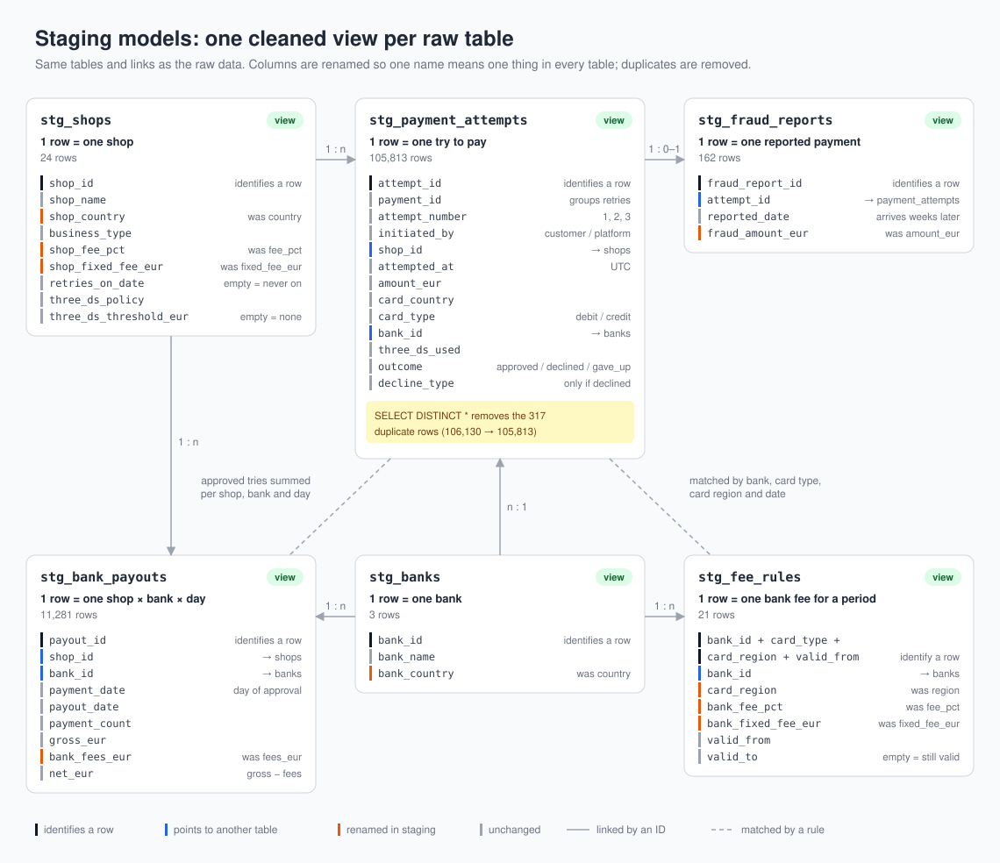

### Intermediate models

Here the cleaned staging views are combined into the building blocks that the mart models read.

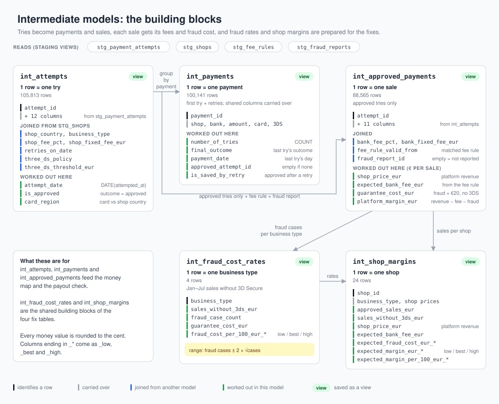

- **int_attempts:** one row per try, with its shop's details, whether it was approved, and its card region.
- **int_payments:** one row per payment (first try plus retries), with its final outcome and number of tries.
- **int_approved_payments:** one row per sale, with four money columns:
  - platform revenue (`shop_price_eur`) = amount × shop % + shop fixed fee
  - expected bank fee = amount × bank % + bank fixed fee
  - fraud cost (`guarantee_cost_eur`) = amount + €20, when the sale was reported as fraud and had no 3D Secure
  - platform margin = platform revenue − bank fee − fraud cost
- **int_fraud_cost_rates** and **int_shop_margins:** the fraud cost per €100 of sales for each business type, and each shop's expected margin for the year.

### Mart models

The final tables with the key metrics, ready for reporting and read by the dashboard.

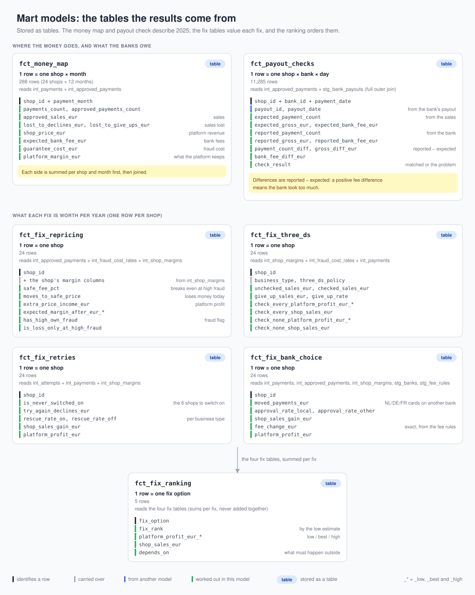

- **fct_money_map:** one row per shop and month: sales, platform revenue, bank fees, fraud cost, margin, and sales lost to declines and to customers giving up.
- **fct_payout_checks:** one row per shop, bank and day, comparing the expected payout with what the bank paid.
- **fct_fix_repricing, fct_fix_bank_choice, fct_fix_three_ds, fct_fix_retries:** one row per shop with the value of each fix.
- **fct_fix_ranking:** the five fix options, ranked.

## Tests

Every model, from staging to marts, has automated tests that protect data quality. `dbt build` runs 135 tests, and a failing test stops the build. From the core models on, I broke each test once on purpose to make sure it can fail, proving that it really checks the data instead of passing no matter what.

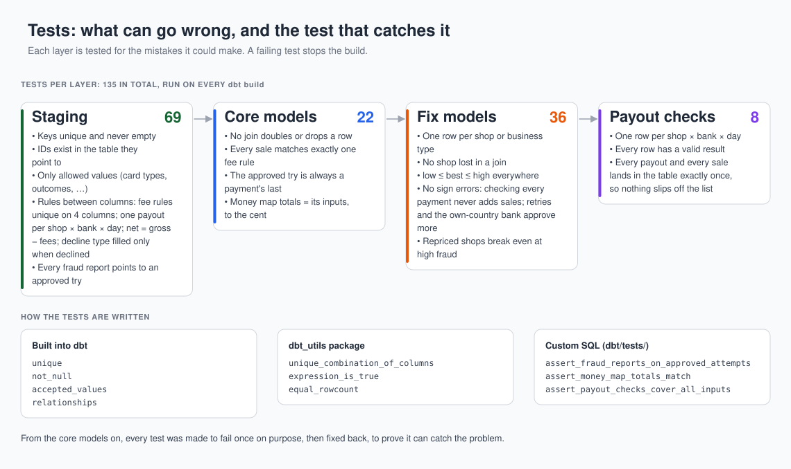

- **Staging (69):** keys are unique and filled, IDs exist in the table they point to, columns hold only allowed values, rules between columns hold (for example net = gross − fees on payouts), and every fraud report points to an approved try.
- **Core models (22)**, the first three intermediate models and the money map: no join doubles or drops rows, every sale matches exactly one fee rule, and the money map's totals equal its inputs to the cent.
- **Fix models (36):** one row per shop or business type, low ≤ best ≤ high everywhere, and no sign errors.
- **Payout checks (8):** every payout and every sale lands in the table exactly once, so nothing can slip off the exception list.

## How each fix is valued

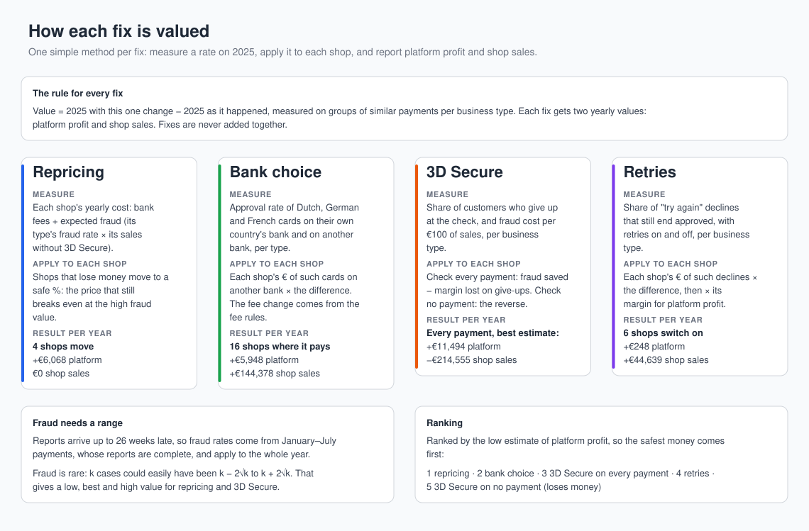

Each fix gets two yearly values, measured on 2025: platform profit and shop sales. They differ a lot. A saved €100 sale is worth €100 to the shop but only about €0.37 to the platform.

- Each fix is valued on its own, against 2025 as it happened. Fixes are never added together, because some sales could be saved by more than one of them.
- Rates are measured on groups of similar payments, per business type. Nothing is claimed about a single payment.
- Every rate is measured from the data, not taken from the generator's settings.

**Fraud** needs extra care. Reports arrive up to 26 weeks late, so fraud rates are measured on January–July payments, whose reports have all arrived, and applied to the whole year. Fraud is also rare, so each rate gets a range: k cases could easily have been anywhere from k − 2√k to k + 2√k. The low estimate of a fix uses whichever end of that range makes the fix look worse. The fraud cost per €100 of sales without 3D Secure (best estimate) is €1.90 for digital subscriptions, €0.40 for travel, €0.18 for online retail and €0.13 for food delivery.

**Repricing.** A shop's cost is its bank fees plus its expected fraud. Shops that lose money move to a safe price: the % that still breaks even if fraud is at the high end of its range. Four shops move (S12, S16, S01, S19), which adds €6,068 a year for the platform and doesn't change shop sales. Two shops are flagged instead of repriced: S14 has far more fraud than its business type (29 cases where about 15 were expected), and S13 loses money only if fraud runs high.

**Bank choice.** A Dutch, German or French card is approved more often by its own country's bank, by 1.2 to 3.6 percentage points, depending on the business type. Sending these cards there at the 16 shops where it pays adds €5,948 a year for the platform and €144,378 of shop sales. The fee change comes straight from the fee rules. This assumes a card's country doesn't change its chance of approval by itself.

**3D Secure.** Checking a payment means the platform no longer pays for its fraud, but some customers give up at the check: from 4.3% in travel to 13.7% in digital subscriptions. Checking every payment earns the platform €4,984 (low), €11,494 (best) or €18,002 (high) a year, and costs the shops €214,555 of sales. Checking no payment costs the platform €51,439 (low), €31,118 (best) or €10,797 (high) a year, and gives the shops €478,588 of sales back.

**Retries.** The rescue rate is the share of payments with a "try again" first decline that still end approved. Customers rescue some themselves by pressing "pay" again; automatic retries add another 15 to 23 percentage points. Switching retries on at the 6 shops without them adds €248 a year for the platform and €44,639 of shop sales.

**Ranking.** The fixes are ranked by the low estimate of platform profit, so the safest money comes first: repricing, bank choice, 3D Secure on every payment, retries and, last, 3D Secure on no payment.

## Payout checks

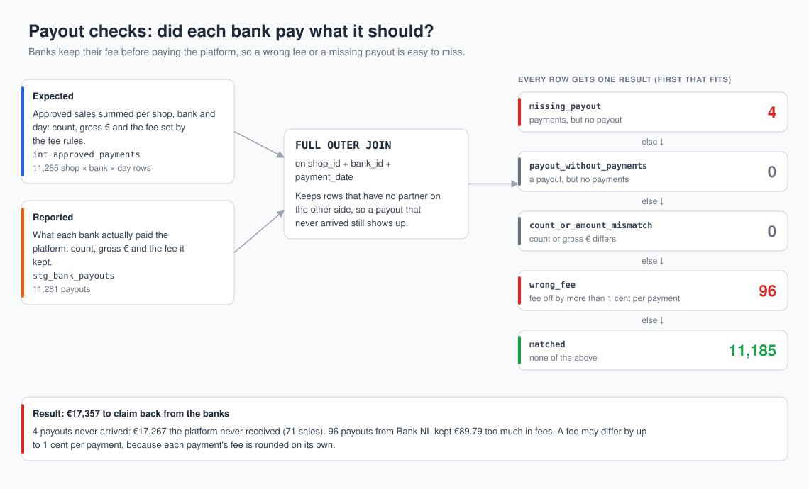

A bank keeps its fee before it pays the platform, so a wrong fee or a missing payout may easily go unnoticed. `fct_payout_checks` puts the payout each shop, bank and day should get next to what the bank actually paid, and labels every row: `matched`, `missing_payout`, `payout_without_payments`, `count_or_amount_mismatch` or `wrong_fee`. A fee may be off by 1 cent per payment, because each payment's fee is rounded on its own.

Result: 4 payouts never arrived (€17,267 owed to the platform), and 96 payouts from Bank NL took €89.79 too much in fees. That is €17,357 to claim back from the banks.

## Checked against the hidden answers

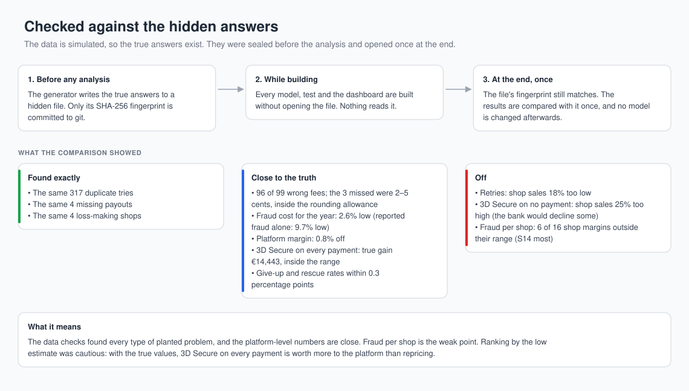

The generator wrote the true answers to a file the models never read, and its fingerprint was committed before any analysis. After everything was built, I compared the results with it once and changed nothing afterwards.

- Found: the same 317 duplicates, the same 4 missing payouts, 96 of the 99 wrong fees (the 3 missed were 2–5 cents each, within the rounding allowance), and the same 4 loss-making shops.
- The fraud cost for the year is 2.6% below the truth; reported fraud alone would be 9.7% below. The platform margin is 0.8% off.
- 3D Secure on every payment: the true platform gain (€14,443) is inside the estimated range.
- Retries: shop sales are 18% too low. 3D Secure on no payment: shop sales are 25% too high, because the bank would have declined some of the payments won back.
- The weak point is fraud per shop. A rate per business type misses shops like S14, and 6 of 16 shop margins fall outside their range.
- Ranking by the low estimate is cautious. With the true values, 3D Secure on every payment is worth more to the platform than repricing.

## Dashboard

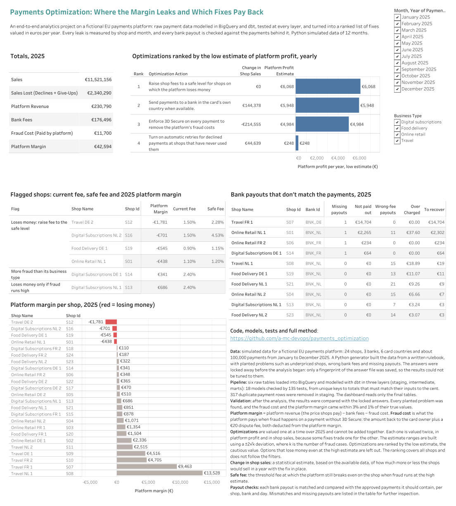

The [Tableau Public page](https://public.tableau.com/app/profile/cihan.ak.n/viz/PaymentsOptimization-MarginLeaksandFixes/Overview) names the fixes in plain words.